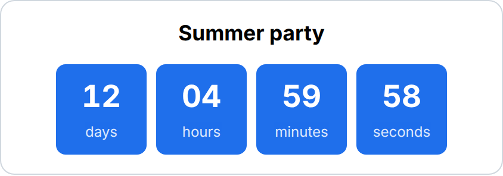
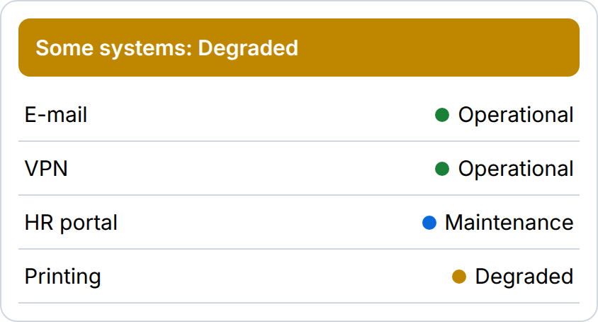
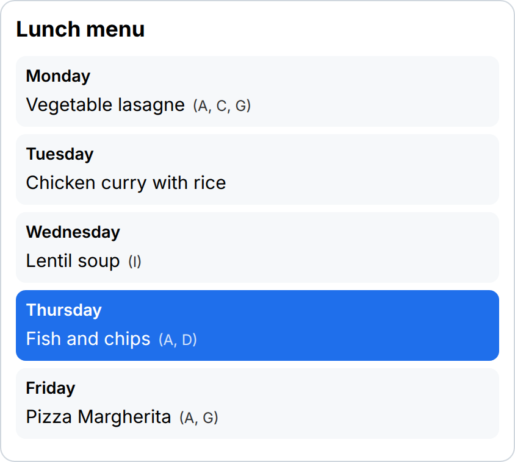
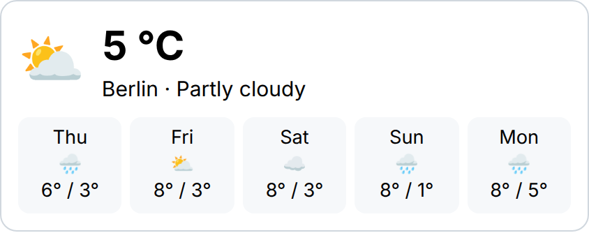

# Staffbase widget templates

Small, working Staffbase custom widgets you can read, copy and adapt. Each one is plain TypeScript on top of Staffbase's public [`@staffbase/widget-sdk`](https://www.npmjs.com/package/@staffbase/widget-sdk) and builds to a single script file.

Prefer not to write code? Each widget below also exists in [Widget Builder](https://www.widgetbuilder.de/en/), where you build and change it in the browser. The free plan covers up to two widgets.

| Template | Preview | Build it without code |
| -------- | ------- | --------------------- |
| [Countdown Timer](templates/countdown-timer/) |  | [widgetbuilder.de](https://www.widgetbuilder.de/en/widgets/countdown-timer/) |
| [IT Service Status](templates/it-service-status/) |  | [widgetbuilder.de](https://www.widgetbuilder.de/en/widgets/it-service-status/) |
| [Lunch Menu](templates/lunch-menu/) |  | [widgetbuilder.de](https://www.widgetbuilder.de/en/widgets/lunch-menu/) |
| [Weather](templates/weather-widget/) |  | [widgetbuilder.de](https://www.widgetbuilder.de/en/widgets/weather-widget/) |

## Develop

Needs [Bun](https://bun.sh) 1.4 or newer.

```sh
bun install
bun run build        # dist/<template>.js, one file per widget
bun run test         # builds, then runs the smoke tests
bun run lint && bun run check-types
bun run screenshots  # refreshes templates/*/screenshot.png (needs Chrome; set CHROME_PATH if not /usr/bin/google-chrome)
```

Each template folder holds `widget.ts` (the widget), `index.ts` (registers it with `window.defineBlock`), a README and a screenshot. `demo/host.html` is a tiny stand-in for a Staffbase page, used for the screenshots.

To run a widget in Staffbase, host its built file on HTTPS and register it as a custom widget, as described in Staffbase's [custom widget documentation](https://developers.staffbase.com/frameworks/customwidget-development/).

## Licence

MIT, see [LICENSE](LICENSE). Staffbase is a trademark of Staffbase SE; this project is not affiliated with Staffbase.
