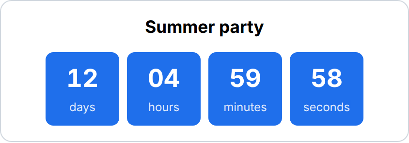

# Countdown Timer

Counts down to an event or deadline in days, hours, minutes and seconds, then shows a custom message.

**Build this without code:** [widgetbuilder.de/en/widgets/countdown-timer](https://www.widgetbuilder.de/en/widgets/countdown-timer/) ([Deutsch](https://www.widgetbuilder.de/de/widgets/countdown-timer/))

## Settings

| Setting | What it does |
| ------- | ------------ |
| `heading` | Title above the countdown |
| `target` | Date and time to count down to, ISO 8601 with time zone (e.g. `2027-06-30T17:00:00+02:00`) |
| `donetext` | Text shown once the target time has passed |

## Use it

1. `bun install && bun run build` in the repo root.
2. Host `dist/countdown-timer.js` on an HTTPS URL you control.
3. Register that script as a custom widget in your Staffbase instance, as described in Staffbase's [custom widget documentation](https://developers.staffbase.com/frameworks/customwidget-development/).
4. Add the widget to a page in Staffbase Studio and fill in the settings.

The widget code is in [`widget.ts`](widget.ts); its smoke test is in [`tests/countdown-timer.test.ts`](../../tests/countdown-timer.test.ts).
