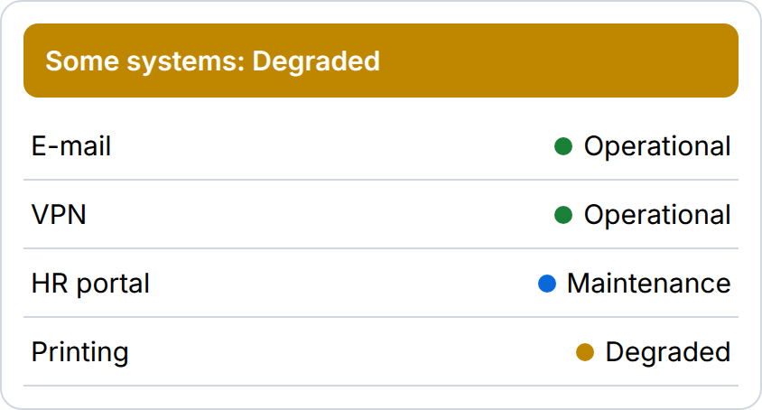

# IT Service Status

Shows the status of internal systems with an overall banner. Four levels: operational, maintenance, degraded, outage.

**Build this without code:** [widgetbuilder.de/en/widgets/it-service-status](https://www.widgetbuilder.de/en/widgets/it-service-status/) ([Deutsch](https://www.widgetbuilder.de/de/widgets/it-service-status/))

## Settings

| Setting | What it does |
| ------- | ------------ |
| `services` | One service per line: `Name \| status`. Unknown status words count as degraded |
| `statusurl` | Optional JSON endpoint returning `[{ "name": "…", "status": "…" }]`. It must allow CORS requests from your Staffbase domain |
| `refreshseconds` | How often the endpoint is polled (minimum 30) |

If the endpoint fails, the widget keeps showing the `services` list and adds a short error line.

## Use it

1. `bun install && bun run build` in the repo root.
2. Host `dist/it-service-status.js` on an HTTPS URL you control.
3. Register that script as a custom widget in your Staffbase instance, as described in Staffbase's [custom widget documentation](https://developers.staffbase.com/frameworks/customwidget-development/).
4. Add the widget to a page in Staffbase Studio and fill in the settings.

The widget code is in [`widget.ts`](widget.ts); its smoke test is in [`tests/it-service-status.test.ts`](../../tests/it-service-status.test.ts).
