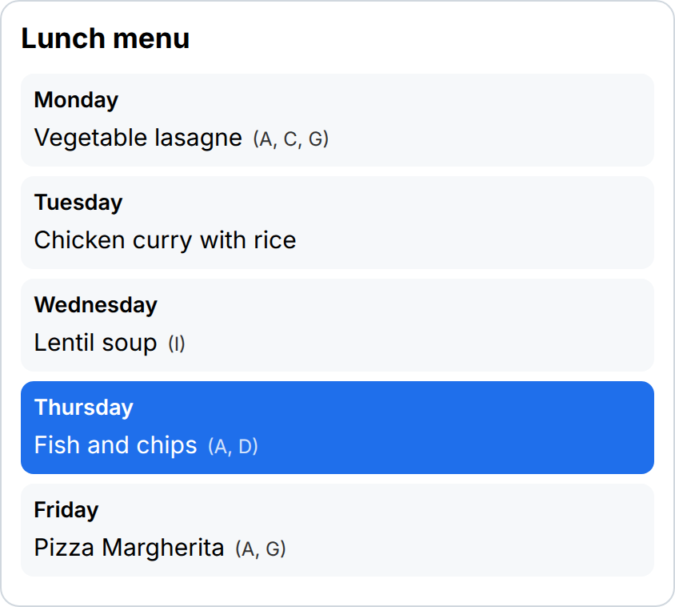

# Lunch Menu

Shows the week's canteen menu with allergen codes and highlights today.

**Build this without code:** [widgetbuilder.de/en/widgets/lunch-menu](https://www.widgetbuilder.de/en/widgets/lunch-menu/) ([Deutsch](https://www.widgetbuilder.de/de/widgets/lunch-menu/))

## Settings

| Setting | What it does |
| ------- | ------------ |
| `heading` | Title above the menu |
| `menu` | One dish per line: `Day \| Dish \| Allergens`. Day names in English or German (`Mon`, `Monday`, `Mo`, `Montag` …) |
| `todayonly` | Show only today's dishes |

## Use it

1. `bun install && bun run build` in the repo root.
2. Host `dist/lunch-menu.js` on an HTTPS URL you control.
3. Register that script as a custom widget in your Staffbase instance, as described in Staffbase's [custom widget documentation](https://developers.staffbase.com/frameworks/customwidget-development/).
4. Add the widget to a page in Staffbase Studio and fill in the settings.

The widget code is in [`widget.ts`](widget.ts); its smoke test is in [`tests/lunch-menu.test.ts`](../../tests/lunch-menu.test.ts).
