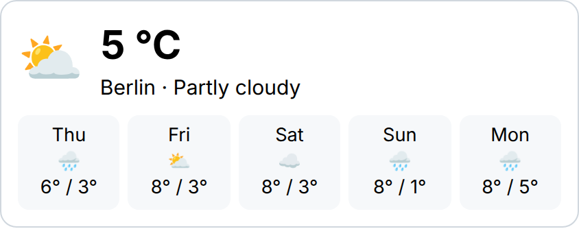

# Weather

Shows current weather and a forecast of up to 7 days for one location, using the free [Open-Meteo](https://open-meteo.com/) API (no API key).

**Build this without code:** [widgetbuilder.de/en/widgets/weather-widget](https://www.widgetbuilder.de/en/widgets/weather-widget/) ([Deutsch](https://www.widgetbuilder.de/de/widgets/weather-widget/))

## Settings

| Setting | What it does |
| ------- | ------------ |
| `location` | Name shown next to the temperature |
| `latitude`, `longitude` | Coordinates of the location |
| `days` | Number of forecast days, 1–7 |

Open-Meteo's free API is for non-commercial use only. Commercial use, which includes most company intranets, needs a paid Open-Meteo API plan: see the [Open-Meteo terms](https://open-meteo.com/en/terms) and [pricing](https://open-meteo.com/en/pricing). This template calls the free endpoint `api.open-meteo.com` without an API key; with a paid plan, change the URL in `widget.ts` to the endpoint and key Open-Meteo gives you.

## Use it

1. `bun install && bun run build` in the repo root.
2. Host `dist/weather-widget.js` on an HTTPS URL you control.
3. Register that script as a custom widget in your Staffbase instance, as described in Staffbase's [custom widget documentation](https://developers.staffbase.com/frameworks/customwidget-development/).
4. Add the widget to a page in Staffbase Studio and fill in the settings.

The widget code is in [`widget.ts`](widget.ts); its smoke test is in [`tests/weather-widget.test.ts`](../../tests/weather-widget.test.ts).
